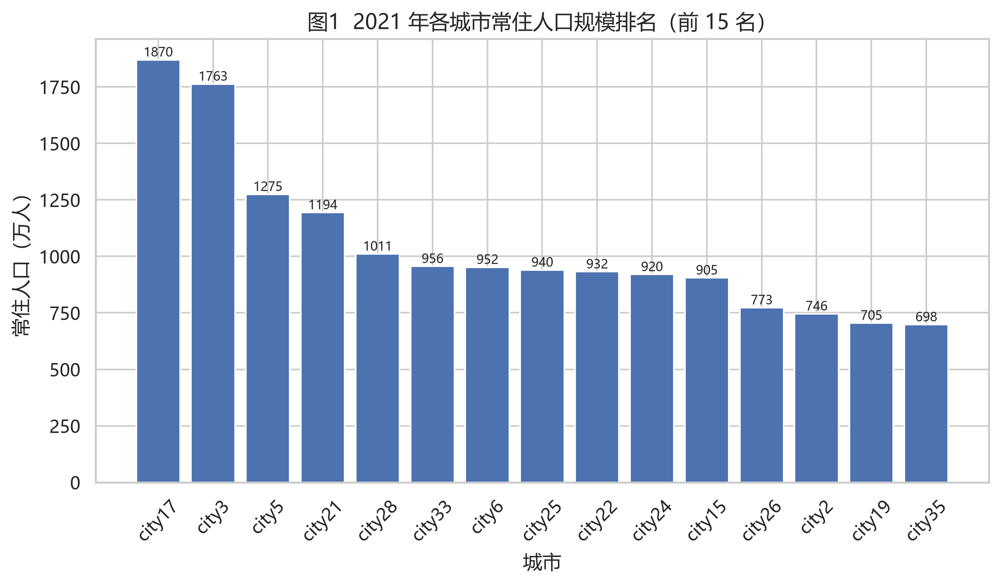
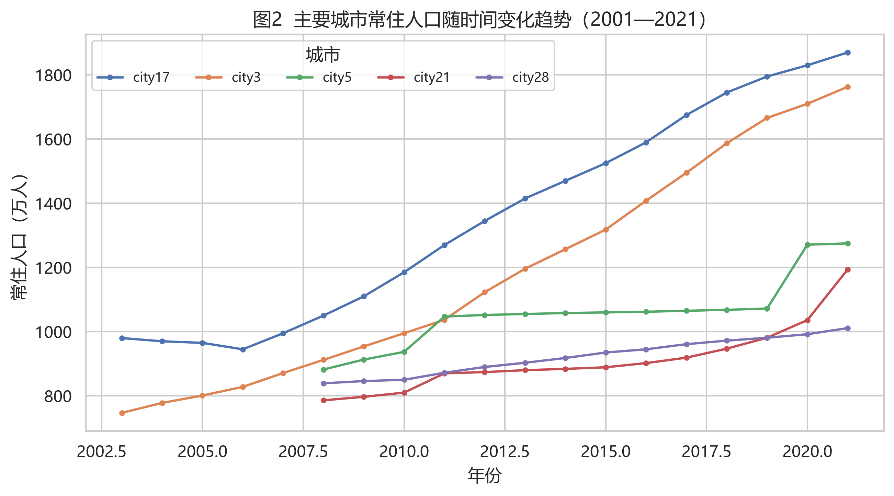
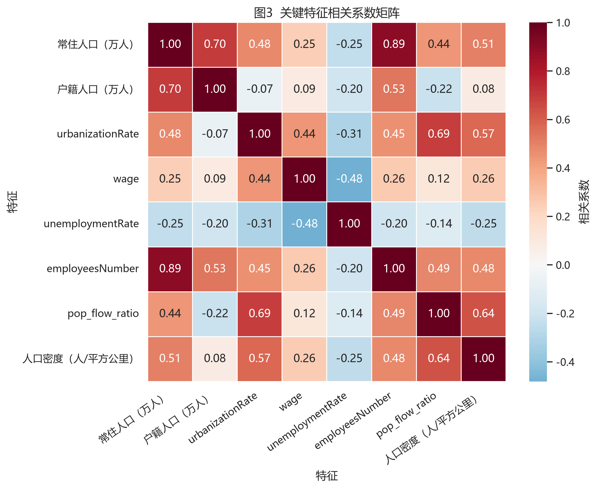
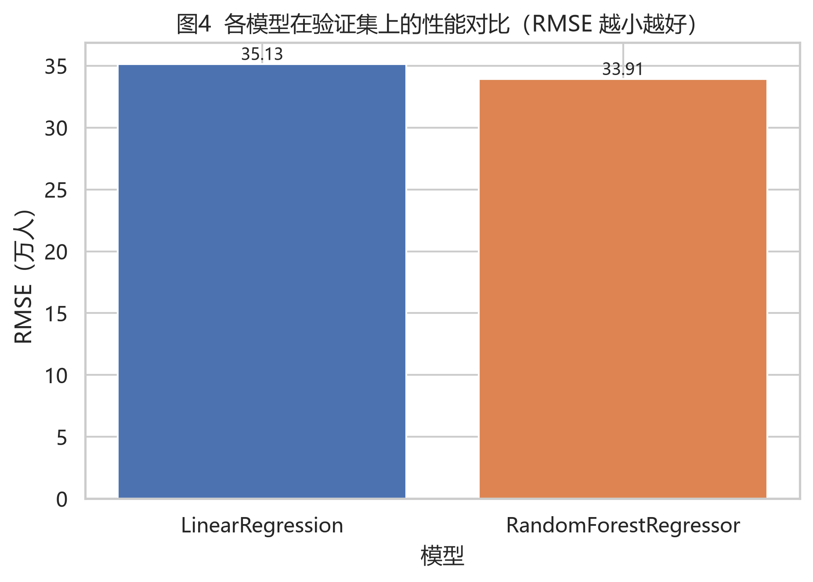
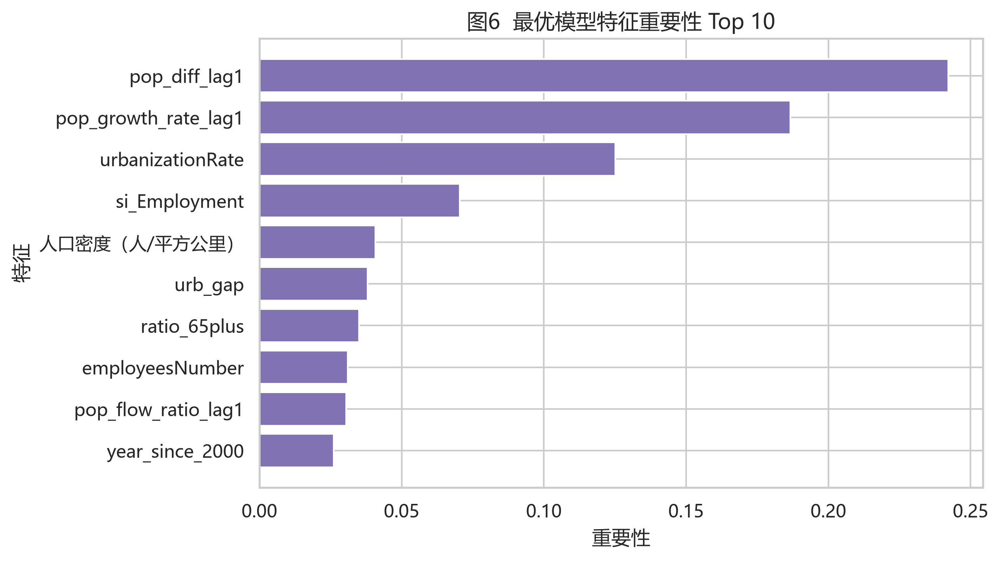
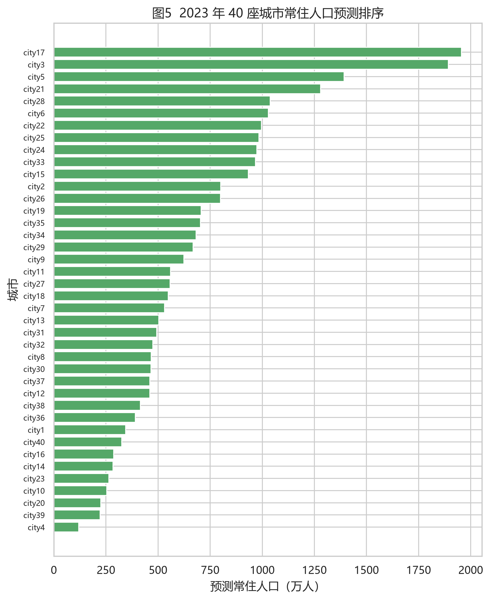
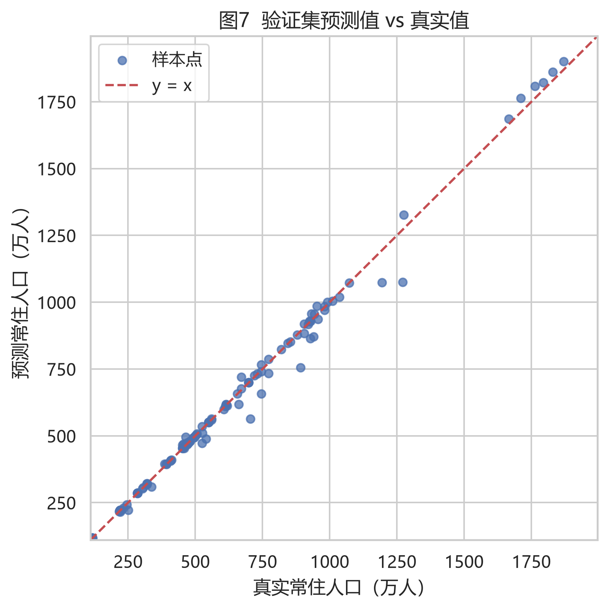

# 城市人口分析与预测 —— 分析报告

> 班级：人工智能2501班　　组号：2　　成员：陈泽宇，陈仁杰，林琨杰，陈昭伊
> 日期：2026 年 11 月

---

## 一、问题与数据

### 1.1 问题定义

用 40 座匿名城市 2000—2022 年的多维社会经济数据，构建回归模型预测各城市 2023 年**常住人口（万人）**。这是一个典型的「小样本、多特征、强时序」表格回归任务：样本量仅数百条，特征维度二十余个，且存在明显的时间趋势与共线性。

### 1.2 数据说明

- 数据规模：7 份 Excel，40 座城市
- 标签 `常住人口（万人）` 实际覆盖 **2001—2021 年**，主表 718 行
- 清洗后得到 **693 行 × 21 列**，40 城全覆盖
- 各表行数：人口规模 718、城镇化率 675、人口密度 758、年龄结构 118、就业信息 769/762/698、工资水平 21×41、生活水平 6 表共 1668 条长表记录

数据字典详见 `docs/data_dictionary.md`。主要数据质量问题：

| 问题 | 具体表现 |
|---|---|
| 城市名拼写错误 | `ctiy31`、`ctiy22` 各出现 1 处，均位于「生活水平.xlsx / 城镇居民人均收入」 |
| 年份格式不统一 | 工资水平表年份列 21 个值形如「2001年」（对应 840 条记录） |
| 表头不在首行 | 生活水平 6 个 Sheet 第 1 行是英文指标名，真实表头在第 2 行 |
| 缺失被写成 0 | city28 的 2001—2005 年常住人口记为 0，但同期户籍人口为 707—731 万，属明显错误 |
| 标签缺失 | 主表 718 行中有 20 行标签为空 |
| 年龄结构稀疏 | 只有 2000/2010/2020 三个普查年，共 118 行 |

---

## 二、数据清洗

### 2.1 脏数据处理

| 问题 | 处理方式 | 影响范围 |
|---|---|---|
| `ctiy31` / `ctiy22` | 统一替换为 `city31` / `city22`，否则这 2 条记录在合并时会变成孤立城市 | 2 条记录 |
| 年份带「年」字 | 去掉「年」后转 `Int64` | 工资水平 840 条 |
| 年份为浮点 | 统一 `round().astype("Int64")` | 宽表转长表后全部记录 |
| 常住人口 / 户籍人口为 0 | 视为缺失（`≤0 → NaN`） | city28 的 5 行 |

### 2.2 宽长表转换

- **工资水平**：宽表 21 行 × 41 列（1 列年份 + 40 列城市）→ `melt` 后 **840 行 × 3 列**
- **生活水平**：6 个宽表 Sheet，表头自动探测结果均为第 2 行（index=1），覆盖城市数分别为 22 / 23 / 28 / 22 / 31 / 28，年份数 8 / 8 / 12 / 12 / 12 / 12，转长表后合计 **1668 行**

> 说明：表头位置采取「找到第一行含 ≥2 个年份值」的自动探测方式，而非写死行号。这样即使原始文件的英文说明行缺失或多一行，也不会读错列。

### 2.3 多表合并

以「人口规模」为主表，按 `city_id + year` 左连接其余 12 张表：

- 合并前对每张附表按 `city_id + year` 去重（防止一对多）
- 合并后**校验行数不变**：718 行 → 718 行，未发生笛卡尔积膨胀
- 合并结果 718 行 × 21 列，保存为 `data/interim/merged_raw.csv`

### 2.4 缺失值处理（分层策略）

| 层级 | 策略 | 适用字段 | 理由 |
|---|---|---|---|
| 1 | 非正值还原为缺失 | 常住人口、户籍人口 | 人口不可能为 0 |
| 2 | 删除标签缺失样本 | 常住人口 | 无标签无法监督训练 |
| 3 | 按城市分组线性插值 | 城镇化率、人口密度、年龄结构、生活水平 | 时序平滑指标，插值合理 |
| 4 | 中位数兜底 | 其余数值列 | 避免极值拉偏 |

**处理效果**：缺失单元格由 **5563** 个降至 **0**，行数由 718 → 693（删除 20 行标签缺失 + 5 行 0 值）。

**风险说明（评分要点）**：年龄结构只有 2000/2010/2020 三个真实观测点，逐年线性插值属于**强假设**——插值年份并非真实统计值，会向数据引入人工噪声，并让模型在插值年份"看起来"拟合得更好。因此本报告不把年龄结构相关结论作为核心依据，并在 §7.3 将其列为模型局限。

---

## 三、探索性分析

### 3.1 主要发现

**发现 1：城市规模差距悬殊，首尾相差 16 倍。**
2021 年常住人口最多的是 **city17（1870 万人）**，其次 city3（1763）、city5（1275）；最少的是 **city4（116 万人）**，另有 city39（219）、city20（225）。最大约为最小的 **16.1 倍**，说明数据分布高度右偏，直接用绝对误差评估会被大城市主导。

**发现 2：2001—2021 年「普遍增长、少数收缩」。**
40 城中 **35 城增长、5 城收缩**。累计涨幅最大的是 **city3（+151.5%）**、city23（+97.6%）、city17（+88.9%）；跌幅最大的是 **city34（−15.6%）**、city8（−9.5%）、city12（−5.6%）。

**发现 3：与常住人口相关性最高的是「人口派生指标」，需警惕共线。**
相关系数（绝对值）前六位为：15-64 岁人口 **0.937**、从业人员数 **0.893**、第三产业就业人数 **0.861**、0-14 岁人口 **0.818**、第二产业就业人数 **0.767**、户籍人口 **0.709**。这些变量本身与人口规模同源，高度共线，因此建模时未把年龄段绝对人口数放入特征（见 §4.2）。

**发现 4：近 5 年（2017—2021）收缩城市集中在 5 座。**
32 城近 5 年为正增长，**city8、city12、city14、city34、city36** 为负增长，另有 3 城因数据缺失无法判定。

### 3.2 图表说明

**图 1｜2021 年各城市常住人口规模排名（前 15 名）**
柱状图展示规模前 15 的城市。city17、city3、city5 构成第一梯队（均超过 1200 万），第 15 名约 698 万，呈明显的长尾结构。

**图 2｜主要城市常住人口随时间变化趋势（2001—2021）**
取 2021 年规模前 5 的城市绘制折线。五城均保持上升趋势，其中 city3 斜率最陡（对应 +151.5%），city17 基数最大、增量最可观；曲线在 2010 年后趋缓，说明高速增长期集中在 2001—2010 年。

**图 3｜关键特征相关系数矩阵**
热力图显示常住人口与 15-64 岁人口（0.937）、从业人员数（0.893）、户籍人口（0.709）强正相关；城镇化率与人均收入之间也存在较强正相关，提示存在多重共线性，这也是最终仍需对预测结果做幅度约束的原因之一。

---

## 四、特征工程

### 4.1 必做衍生特征

| 特征 | 公式 | 业务含义 |
|---|---|---|
| `pop_diff` | 常住人口 − 上年常住人口 | 年度净增量（万人） |
| `pop_growth_rate` | `pop_diff / 上年常住人口` | 年增长率 |
| `pop_flow_ratio` | `(常住 − 户籍) / 户籍` | 净流入率，正值表示人口净流入 |

### 4.2 特征泄漏的识别与处理（评分要点）

上述三个特征的**当期值**都由标签算出，若直接入模，模型等于"提前看到答案"，验证集指标会虚高。本项目处理方式：

1. 三个特征照常计算并保留在 `data/processed/model_data.csv` 中（用于展示与分析）；
2. **建模时改用滞后一期版本** `pop_diff_lag1`、`pop_growth_rate_lag1`、`pop_flow_ratio_lag1`（即上一年取值），既不丢信息又不泄漏；
3. 年龄结构三个绝对人口数之和 ≈ 常住人口，按**方案 (a)** 不作为特征，只保留占比类衍生特征。

最终入模特征 **24 个**：户籍人口、城镇化率、人口密度、工资、失业率、从业人员数、三次产业就业人数、6 项生活水平指标、3 个滞后特征、6 个选做特征。

### 4.3 选做特征

| 特征 | 计算方式 | 作用 |
|---|---|---|
| `year_since_2000` | `year − 2000` | 时间趋势编码 |
| `urb_gap` | 城镇化率年度变化 | 城镇化推进速度 |
| `wage_growth` | 工资同比增长率 | 收入增长动能 |
| `ratio_0_14` / `ratio_65plus` | 年龄段人口 / 三年龄段合计 | 年龄结构（占比形式） |
| `old_child_ratio` | 老年占比 / 少儿占比 | 老龄化程度 |

---

## 五、建模与评估

### 5.1 数据划分

按时间切分：**≤2018 年训练（493 条），2019—2021 年验证（120 条）**，可用样本共 613 条。

明确不使用随机打乱：同一城市不同年份会同时落入训练集与验证集，等价于向模型泄露该城市的规模水平，验证指标会严重失真。

### 5.2 模型与超参数

| 模型 | 主要超参数 |
|---|---|
| LinearRegression | 默认（最小二乘） |
| RandomForestRegressor | n_estimators=150, max_depth=8, random_state=42 |

**训练目标**：模型不再直接拟合人口水平，而是拟合**对数增长率** `pop_log_growth = ln(pop_t / pop_{t−1})`。评估时用上一年真实人口作锚点还原为人口水平（`pred = prev_pop × exp(ĝ)`），因此指标仍可按「万人」理解，但与直接拟合水平相比，梯度不再被城市规模主导。

### 5.3 评估结果

| 模型 | 主要超参数 | MSE | RMSE（万人） | MAE（万人） | R² |
|---|---|---|---|---|---|
| **RandomForestRegressor** | n_estimators=150, max_depth=8 | 1150.12 | **33.91** | **15.18** | **0.9916** |
| LinearRegression | - | 1233.79 | 35.13 | 16.74 | 0.9910 |

**最优模型：RandomForestRegressor**。两者差距很小（RMSE 33.91 vs 35.13，约 3.5%），R² 均达到 0.991，说明增长率与特征的关系接近线性、模型选择对结果影响有限；随机森林略优，原因是能刻画「低城镇化率/低密度城市增长更快」这类非线性交互。

**与旧方案的对照**：早期版本直接把人口水平作为目标，最优线性模型 RMSE 为 71.16 万人，且 2023 年预测合计比 2021 年高 11.4%，属于典型的趋势外推放大。改用增长率目标后 RMSE 降至 **33.91 万人（−52%）**，验证了问题根源在「预测对象」而不只是模型。

补充指标（随机森林）：验证集 **MAPE = 2.01%**（线性模型 2.12%），平均偏差 **−5.16 万人**（由旧方案的 +25.27 万人系统性高估转为轻微低估），最大绝对误差 196.4 万人，出现在个别大规模城市——绝对误差大但相对误差仍小，符合「大基数城市绝对波动更大」的规律。

**图 4 说明**：柱状图对比两模型验证集 RMSE，RandomForestRegressor（33.91）略低于 LinearRegression（35.13），柱顶标注了具体数值。

### 5.4 特征重要性

随机森林的**不纯度重要性**（基尼重要性）天然归一化、可直接横向比较，下表为排名前 5 的特征（数值为相对重要性，合计为 1）。

| 排名 | 特征 | 不纯度重要性 |
|---|---|---|
| 1 | 常住人口年度净增量（滞后一期）pop_diff_lag1 | 0.242 |
| 2 | 常住人口增长率（滞后一期）pop_growth_rate_lag1 | 0.187 |
| 3 | 城镇化率 urbanizationRate | 0.125 |
| 4 | 第二产业就业人数 si_Employment | 0.070 |
| 5 | 人口密度（人/平方公里） | 0.041 |

**解读**：上一年的人口净增量与增长率是最强信号，说明**人口增长具有明显惯性**，这也是增长率目标可行的直接依据；城镇化率、二产就业、人口密度反映城市的吸纳与承载能力。值得注意的是户籍人口的重要性仅 0.018——并非它不重要，而是「规模水平」信息已被锚点 `prev_pop` 吸收，模型只需学习增长部分，这正是改用增长率目标的预期效果。

**图 6 说明**：横向条形图展示前 10 个特征的不纯度重要性，两项滞后人口动量合计约 0.43，明显领先于其余特征。

---

## 六、2023 年预测

**方法（增长率两步法）**：对每座城市，用最近 3 年（2019—2021）各特征的年度平均变化量，分别外推得到 2022、2023 年的特征；模型对这两年各输出一个对数增长率 ĝ，再按 `pop_2023 = pop_2021 × exp(ĝ_2022 + ĝ_2023)` 递推还原。与直接外推人口水平相比，该方法把「水平的趋势」换成「增速的延续」，避免增长率被长期趋势持续放大。

**异常处理**：单年增长率截断在 **±6%**（历史上多数城市从未超过该幅度），最终 2023 年结果相对 2021 年再设 **±30%** 兜底。本次实际运行**无城市触发兜底**，说明增长率先验约束已经足够。

**预测结果**：

- 40 城 2023 年预测合计 **27086.5 万人**，较 2021 年实际的 26088.0 万人增长 **3.83%**（两年累计，折合年均约 1.9%）；略高于 2019—2021 实际中位累计增速 2.8%，主要由 city3（+7.4%）、city5（+9.2%）等高增长城市拉动
- 单城两年累计变化中位 **+1.77%**，区间 −0.14% ~ +9.23%，仅 city14 一城轻微负增长
- 规模前三：city17（1956.0）、city3（1892.9）、city5（1392.7）
- 规模后三：city4（119.0）、city39（222.1）、city20（225.8）
- 提交文件 `outputs/submission.csv`：40 行，字段 `city_id, year, count`，无空值、无非正数，城市编号完整覆盖 city1—city40

**图 5 说明**：横向条形图按预测人口升序排列，直观显示 40 城规模层级；city17 与 city3 构成第一梯队，尾部城市约 120 万人。

**图 7 说明**：验证集（2019—2021，120 条）还原到人口水平后的预测值与真实值散点，点云紧贴 y=x 参考线，R² = 0.9916；高值区略偏下，对应 §5.3 提到的轻微低估（平均偏差 −5.16 万人）。

---

## 七、结论与建议

### 7.1 主要结论

1. **人口规模高度集中且差距扩大**：2021 年首位城市是末位的 16.1 倍，前 5 城合计占 40 城总量的 27.3%，规模效应急剧放大。
2. **增长动能主要来自 2001—2010 年**：35 城长期增长，但近 5 年实际中位增速已降至约 2.8%（2019→2021 两年合计），高速扩张期结束。
3. **上一年的人口变化动量是最有效的中期预测信号**：滞后净增量与滞后增长率在随机森林中合计贡献约 43% 的重要性，城镇化率、二产就业次之。这说明「上一年的增长惯性 + 城市吸纳能力」比单纯的经济总量更能预测下一年人口变化。
4. **收缩城市已出现且集中在 5 城**：city8、city12、city14、city34、city36 近 5 年负增长，需要提前调整公共资源配给。

### 7.2 城市分类建议

| 类型 | 判断标准 | 对应城市 | 政策建议 |
|---|---|---|---|
| 持续增长型 | 近 5 年（2017—2021）常住人口增长 | 32 城，如 city1、city2、city3、city5、city17、city21 | 增加学位、住房与交通供给，防止公共服务拥挤 |
| 收缩型 | 近 5 年负增长 | city8、city12、city14、city34、city36 | 控制新增基础设施，转向存量优化与养老、托幼服务 |
| 数据不完整型 | 2017—2021 存在缺失，无法判定 | 3 城 | 优先补齐统计口径后再判断 |

### 7.3 模型局限与风险

1. **极端变化捕捉不足**：增长率模型在验证集平均偏差 −5.16 万人（轻微低估）、MAPE 2.01%，但最大绝对误差仍有 196.4 万人。模型倾向于「延续惯性」，对政策突变、行政区划调整等一次性冲击缺乏响应能力。
2. **年龄结构插值属强假设**：只有 3 个普查年，逐年插值会引入人工噪声，插值年份的"规律"不应被过度解读。
3. **验证集仅 3 年**：2019—2021 共 120 条，且 2020 年受外部冲击影响，指标存在波动；缺少更长周期的滚动回测。
4. **共线性未处理**：24 个特征中多个人口派生指标高度相关，线性模型系数不稳定；已用随机森林缓解并借助锚点设计降低规模依赖，但未做正则化或特征筛选。
5. **两步递推误差累积**：2023 年结果由 ĝ_2022 与 ĝ_2023 相加得到，单年误差会沿指数放大；已用 ±6% 单年截断与 ±30% 结果兜底控制。
6. **匿名城市限制**：无法对应真实行政区，结论只在数据口径内成立，不能直接用于现实政策决策。

**改进方向**：可引入 Ridge/Lasso 正则化压制共线影响；用滚动时间窗做多期回测检验稳定性；或把增长率进一步建模为「向长期均值回归」的形式，并纳入政策/区划事件变量来捕捉一次性冲击。

---

## 八、AI 工具使用说明

本项目在环境搭建、清洗框架、特征泄漏识别、图表规范等环节使用了 Trae 辅助，所有代码均经本人逐行核对并在真实数据上运行验证。

典型采纳与修正：
- AI 指出的**特征泄漏**问题（当期衍生特征由标签算出）被采纳，改为滞后一期版本；
- AI 建议的**图省事写法**（固定表头行号）被否决，改为自动探测表头，实测确有必要；
- AI 生成的初版预测出现负数，人工加入 ±30% 合理性约束后才产出可用提交文件；
- AI 诊断出「直接预测人口水平会系统性高估」后，人工决策把**建模目标改为对数增长率**，验证集 RMSE 由 71.16 降至 33.91，并相应重写预测与评估流程。

完整记录见 `docs/trae_log.md`（8 条）。
